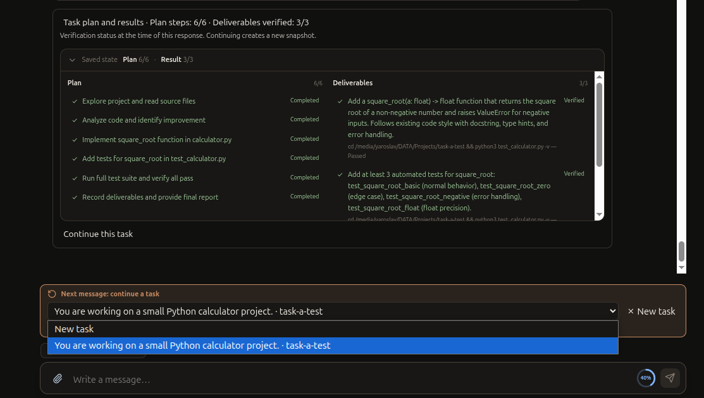

# Local AI Desktop

[English](README.md) · [Русский](README.ru.md)

Local AI Desktop — экспериментальное настольное приложение для Linux: локальный чат с языковыми моделями и AI-агент для работы с кодом. Модель запускается на вашем компьютере через `llama.cpp`; агент может читать и изменять выбранный проект, выполнять команды в изолированном терминале и показывать результаты проверок.

Приложение объединяет локальный AI-чат и работу с кодом, сохраняя беседы и задачи. Вы выбираете модель и проект и управляете разрешениями и изменениями.

[Локальная Experimental Alpha v0.3.0](docs/releases/v0.3.0.ru.md) · [Начало работы](docs/ru/GETTING_STARTED.md) · [Руководство](docs/ru/USER_GUIDE.md) · [Список документации](docs/README.md)

## Что можно делать

- Общаться с локальной моделью GGUF и прикреплять поддерживаемые файлы.
- Поручать Agent изучить проект, внести изменения, выполнить проверки и рассказать о результатах.
- Сохранять планы и подтверждённые результаты задачи, переключать чаты и позже продолжать работу.
- Выбирать, должен ли Agent спрашивать разрешение перед действиями или работать в режиме «Абсолютный автопилот» с теми же обязательными ограничениями.
- Просматривать ответы с таблицами, графиками и диаграммами, экспортировать графики в SVG.
- Выбирать контекст FP16 или Q8 и искать подходящий модели размер контекста.

Текущие возможности и ограничения описаны в разделе [Возможности](docs/ru/FEATURES.md).

## Скриншоты

Продолжайте сохранённую работу из другого чата. В меню можно вернуться к задаче или начать новую.



Rich Responses может объединять карточки и графики, которые можно экспортировать в SVG.


## Требования

Поддерживаемая платформа — Linux x86_64; основная проверенная среда — Ubuntu 24.04. Нужны совместимая сборка `llama-server` и локальные файлы моделей GGUF. Они не входят в приложение. Терминалу Agent также нужны Bubblewrap версии 0.9.0 или новее и AppArmor с профилями enforcing версии 4.0.0 или новее. Другие дистрибутивы, ARM, GPU и драйверы широко не проверялись.

## Установить локальный пакет v0.3.0

Пакет Experimental Alpha v0.3.0 подготовлен локально и не опубликован. Из корня репозитория установите amd64 `.deb`:

```sh
sudo apt install ./release/local-ai-desktop_0.3.0_amd64.deb
```

Администратор должен разрешить каждой desktop-учётной записи использовать терминал Agent. Обязательные шаги настройки и проверки описаны в разделе [Начало работы](docs/ru/GETTING_STARTED.md). Не запускайте приложение от `root`.

## Быстрый старт

1. Установите приложение и выполните настройку изоляции Agent из раздела [Начало работы](docs/ru/GETTING_STARTED.md).
2. Установите совместимый `llama-server`, затем укажите его расположение и модель GGUF в **Настройки → Модели и runtime**.
3. Выберите контекст и тип KV-кэша, загрузите настройки и дождитесь готовности модели.
4. Начните чат. Для работы с кодом выберите проект и переключитесь в Agent. Пока знакомитесь с действиями агента, начните с режима **Запрашивать подтверждение**.

В [Руководстве пользователя](docs/ru/USER_GUIDE.md) описаны элементы управления и основные сценарии.

Рекомендации по размеру контекста, запасу VRAM, MTP и скорости Vision приведены в разделе [Диагностика производительности GPU](docs/gpu-performance-troubleshooting.md#практические-рекомендации).

## Текущие ограничения

Это Experimental Alpha. Приложение не загружает модели; совместимость зависит от GGUF, `llama.cpp`, оборудования и задачи. Изменения Agent записываются в реальные файлы проекта — проверяйте их и сохраняйте резервные копии. Изоляция терминала обязательна, но она не скрывает все читаемые файлы хоста и использует общую сеть. Если безопасно запустить терминал нельзя, его запуск блокируется. Чистая установка и совместимость с широким набором дистрибутивов независимо не проверялись.

## Лицензия

Оригинальный код распространяется по MIT; части, адаптированные из Jan, — по Apache-2.0. См. [LICENSE](LICENSE), [уведомления о сторонних компонентах](THIRD_PARTY_NOTICES.md) и [атрибуцию ресурсов](assets/ATTRIBUTION.md).

## Проект

Это независимо разрабатываемый проект с открытым исходным кодом. [Сообщить об ошибке](https://github.com/Kushch-Yaroslav/local-ai-desktop/issues) можно с шагами воспроизведения и диагностикой без личных данных.
