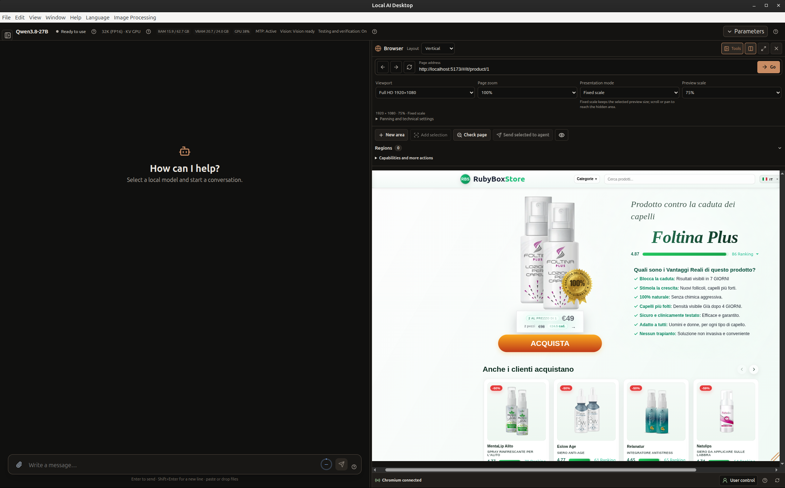
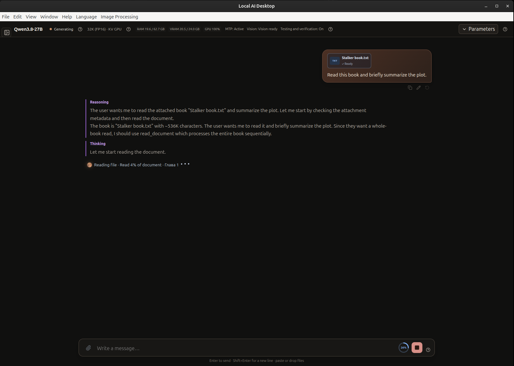

# Local AI Desktop

[English](README.md) · [Русский](README.ru.md)

Local AI Desktop — экспериментальное приложение для Linux: локальный чат с языковыми моделями и AI-агент для работы с кодом. Модель запускается на компьютере через `llama.cpp`; Agent работает с выбранным проектом и сообщает, какие проверки выполнил.

**v0.3.1 Experimental Alpha** — надёжнее загрузка моделей, эффективнее чтение больших документов и восстановление, постепенное отображение проверенных ответов.

[Примечания к выпуску](docs/releases/v0.3.1.ru.md) · [Начало работы](docs/ru/GETTING_STARTED.md) · [Руководство пользователя](docs/ru/USER_GUIDE.md) · [Вся документация](docs/README.md)

## Посмотреть демонстрацию

https://github.com/user-attachments/assets/57c946f5-5263-4dc0-95b4-0d182d3d36e1

**Постановочная демонстрация. Без реального запуска модели.**

## Возможности

- Общаться с локальной моделью GGUF и прикреплять поддерживаемые файлы.
- Просить Agent исследовать проект, внести изменения, выполнить проверки и показать результаты.
- Открывать запущенный локальный веб-проект в Browser Workspace, менять viewport и выбирать одну или несколько областей для обсуждения.
- Поручать Chat последовательно прочитать большой поддерживаемый текстовый документ, затем попросить пересказ или задать дополнительный вопрос.
- Сохранять задачи Agent и возвращаться к ним позже, просматривать план, ход работы и проверки.

Выделите часть страницы и опишите желаемое изменение. Текстовая модель не видит пиксели браузера напрямую: при работе она может использовать сведения об области, элементы страницы и исходники; передача изображения зависит от модели и настроек Vision. Browser Workspace предназначен прежде всего для локальных проектов, а не для защищённого произвольного веб-сёрфинга. Если проекту нужен dev-сервер, запустите его самостоятельно.

## Скриншоты





[Другие скриншоты и подробности v0.3.0](docs/releases/v0.3.0.ru.md#browser-workspace).

## Установка

Скачайте `local-ai-desktop_0.3.1_amd64.deb` и `SHA256SUMS` со [страницы релиза v0.3.1 на GitHub](https://github.com/Kushch-Yaroslav/local-ai-desktop/releases/tag/v0.3.1), проверьте контрольную сумму и установите пакет:

```sh
sudo apt install ./local-ai-desktop_0.3.1_amd64.deb
```

Целевая платформа — Linux x86_64; основная проверенная среда — Ubuntu 24.04. Нужны совместимый `llama-server` и локальные файлы GGUF — они не входят в пакет. Для терминала Agent администратор должен настроить Bubblewrap и enforcing-профили AppArmor. Не запускайте приложение от `root`.

## Ограничения

Это **Experimental Alpha**, а не стабильная или готовая к production версия. Поддержка моделей и результаты зависят от GGUF, `llama.cpp`, оборудования и задачи. Agent меняет реальные файлы — проверяйте их и сохраняйте резервные копии. Изоляция терминала обязательна, но доступные файлы хоста и сеть не являются границей приватности. Другие дистрибутивы Linux, ARM, GPU и драйверы широко не проверялись.

См. [возможности](docs/ru/FEATURES.md), [начало работы](docs/ru/GETTING_STARTED.md), [руководство пользователя](docs/ru/USER_GUIDE.md) и [список документации](docs/README.md). English: [v0.3.0 release notes](docs/releases/v0.3.0.md).

## Лицензия

Оригинальный код распространяется по MIT; части, адаптированные из Jan, — по Apache-2.0. См. [LICENSE](LICENSE), [уведомления о сторонних компонентах](THIRD_PARTY_NOTICES.md) и [атрибуцию ресурсов](assets/ATTRIBUTION.md).
