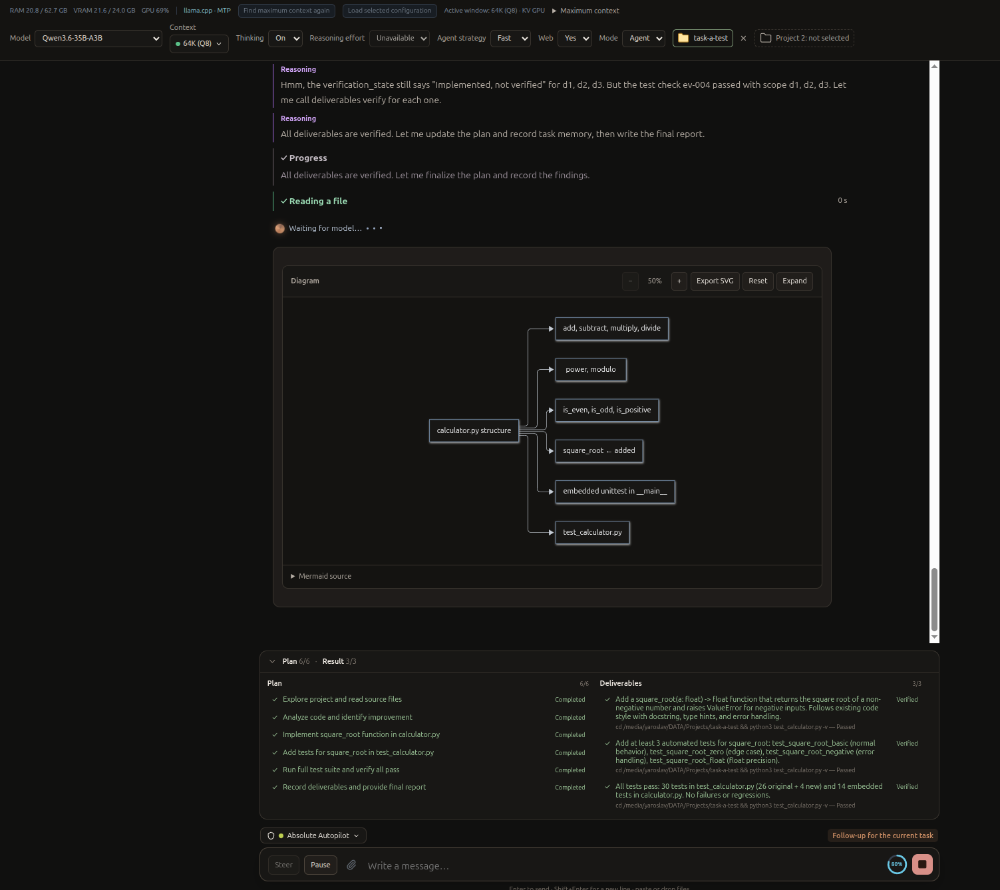
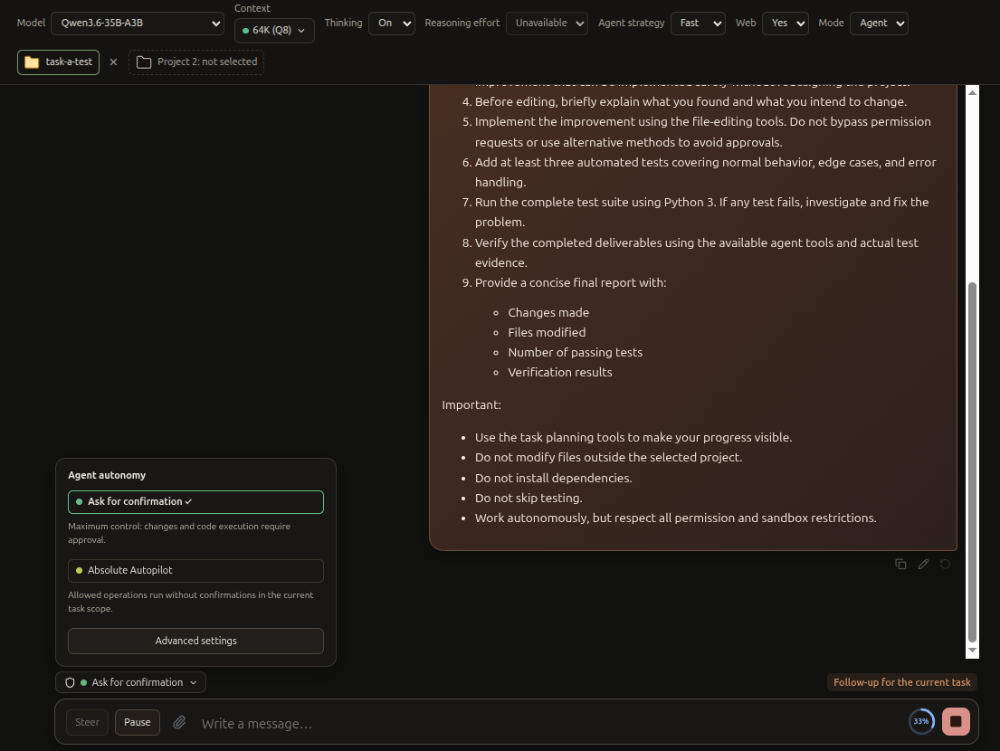
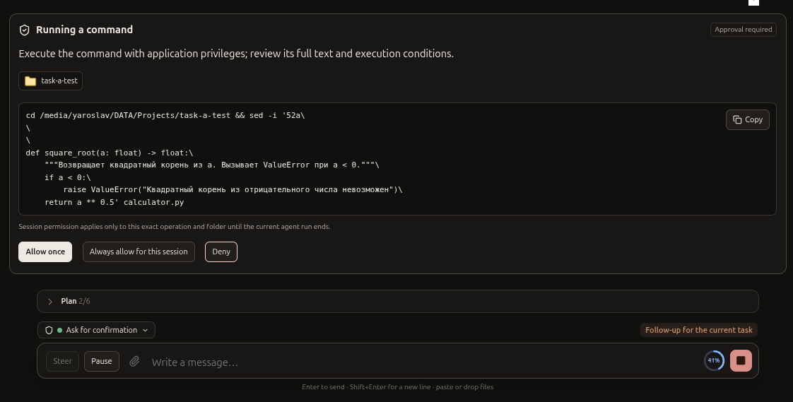
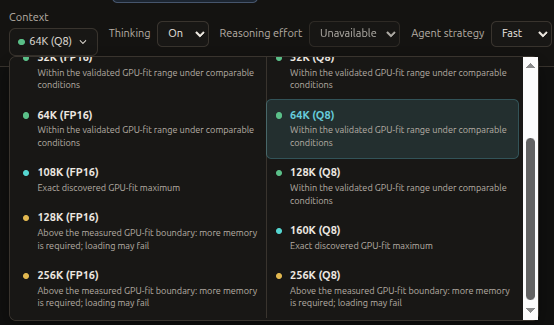
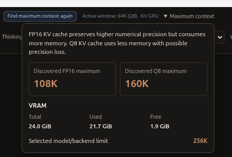

# Archived v0.2.0 release validation and implementation notes

This file preserves the detailed release record that was moved out of the current product notes after publication. It is historical evidence, not current installation guidance.

[Current release notes](../../releases/v0.2.0.md) · [Русские примечания](../../releases/v0.2.0.ru.md) · [Changelog](../../../CHANGELOG.md) · [Archived checklist](v0.2.0-checklist.md)

Compared with v0.1.0, this release improves Agent Runtime V2, Rich Responses and context discovery, alongside the features and fixes below.

**Experimental Alpha pre-release:** [GitHub release](https://github.com/Kushch-Yaroslav/local-ai-desktop/releases/tag/v0.2.0) · [Download the amd64 DEB](https://github.com/Kushch-Yaroslav/local-ai-desktop/releases/download/v0.2.0/local-ai-desktop_0.2.0_amd64.deb) · [SHA256SUMS](https://github.com/Kushch-Yaroslav/local-ai-desktop/releases/download/v0.2.0/SHA256SUMS).

The published DEB is the byte-for-byte tested RC2 artifact (`local-ai-desktop_0.2.0_amd64.deb`), SHA-256 `4d33e2928504fedb519040f5120a302e486674c3d3e7dea07c5edc12ff12f3c0`. Its frozen source-manifest identity is `a9396382dee22aeeca9c7937c744427215552a511b3aff0693626ebb92034002`. The offline release-note copy inside the package predates the final manual Qwen acceptance; this online page records that later result below.

## Screenshots

These five screenshots illustrate the v0.2.0 interface; they are not release acceptance evidence. Image bytes are preserved under `docs/img/releases/v0.2.0/`. Numerical values describe the captured task and hardware, not defaults or compatibility guarantees.

### Agent screenshot: reasoning and plan

Reasoning and a Mermaid diagram appear with a completed plan (6/6) and verified deliverables (3/3). A completed plan is not itself proof; the displayed verification belongs to this task and is not release certification.

### Permission screenshots and approval flow

The composer selector offers **Ask for confirmation** and **Absolute Autopilot**. Changing the workflow does not remove mandatory sandbox or workspace boundaries.

The approval dialog presents the full proposed command and project, with **Allow once**, **Always allow for this session** and **Deny**. The session grant is limited to the operation/folder and current run; the pictured command is an example, not an instruction to execute.

### Context screenshots and discovery

The responsive, scrollable FP16/Q8 selector separates GPU-fit indicators and exact discovered maxima. Status is specific to cache type and comparable conditions; green is not a universal loading guarantee.

The compact information panel shows 108K FP16 and 160K Q8 discovered maxima, a shared total/used/free VRAM summary and a 256K model/backend limit. The active window is 64K Q8, not either discovered maximum. These are captured values, not recommended settings.

## Major improvements

### Reliable Agent V2 execution

Productive work no longer ends solely at the previous fixed work-turn ceiling. Cancellation, tool timeouts, verification review limits and loop recovery remain bounded. Task Memory and observation references retain useful findings across compaction. Failures now carry more actionable retry guidance: patch/context mismatches require rereading and correcting arguments, and stale evidence requires fresh checks rather than identical verification retries.

The launcher monitors unexpected model-server exit and clears stale ready state. Connection recovery retries refused connections only before request bytes are sent, with bounded cancellation-aware waits; it does not replay partially submitted inference. Saved task state survives failures. A replaced running Rust executable reports a restart requirement instead of silently adopting another binary.

### Two modes and enforced terminal protection

The UI offers **Ask for confirmation** and **Absolute Autopilot**. The actual Rust → Electron approval broker handles allow once, scoped run grants, denial, timeout, cancellation and revocation. Legacy mode values normalize for compatibility; trusted-folder management is removed. Autopilot allows permitted operations in established task scope, including local Python workflows, without repeated approval. It blocks mandatory/out-of-scope operations with an explanation and does not expand host access.

Terminal execution uses mandatory Bubblewrap namespaces, capability dropping, NoNewPrivs and seccomp. The reviewed Ubuntu deployment uses a dedicated non-setuid helper and enforcing stacked AppArmor profiles, not a system-wide `/usr/bin/bwrap` attachment. Minimal setup environment allowlists prevent inherited loader hooks from reaching Rust/Bubblewrap setup; payload environment is transported separately. Direct helper exec from the child is denied. An isolation startup error fails closed.

Protected runtime registration follows PID identity/start time, executable, role, parent/group/session, endpoint and lifecycle. Namespace/kernel boundaries protect host processes independently of the command classifier. Managed terminal tasks have owned handles for start/status/stop; ports and arbitrary host PIDs are not cleanup authority. Dedicated user Stop Model/Restart/Quit controls remain separate. See the limitations below; this is not unrestricted-host or confidential-host isolation.

### Independent tasks and immutable history

Stable `logicalTaskId` is separate from conversation, message, generation, analysis run and terminal task handles. Plans, deliverables, Task Memory, verification and checkpoints are task-scoped and persisted in SQLite. Independent requests do not inherit old deliverables. Explicit continuation and Regenerate preserve task ownership while producing separate attempts. Recent-task selection near the composer shows New task/Continue task and project identity.

The active panel remains near the composer only during execution. Completed/paused/failed attempts retain collapsible snapshots near their responses; later attempts cannot rewrite them. Explicit continuation restores a valid saved workspace when no UI project is selected, without trusting model-generated paths. Legacy conversation plans are retained as legacy data; missing historical task boundaries/evidence are not invented.

### Verification tied to actual evidence

Checks must match the task, target scope, required check kind and current revisions. A successful test in A cannot prove non-modification of B; unsupported integrity claims remain unverified without a trusted prior baseline. Standard direct Python unittest drivers now qualify when scoped source structure and actual nonempty test output establish the check, fixing passing scripts previously classified only as runtime execution. Explicit scoped `cd` checks are recognized even when the initial cwd belongs to another task.

Identical file-tool writes and no-op patches preserve files/evidence. Narrow literal terminal writes use observed before/after bytes to avoid unnecessary invalidation; arbitrary mutating scripts remain conservative. Real changes still invalidate checks. Verification counters distinguish implementation from verification and display the corresponding immutable snapshot accurately.

### Two-stage loop recovery

Stage A supplies specific guidance about the repeated action and next concrete task step. If the same loop returns without observed progress, Stage B attempts selective cleanup immediately instead of waiting another full repetition window. Only complete, demonstrably repetitive metadata cycles (including supported `view`/`implemented` patterns) are excluded from the next model request. Productive context, tool-call/result pairing, Task Memory, evidence and all persisted records remain intact.

Ambiguous boundaries pause safely. Repeated cleanup is bounded (currently two attempts); only meaningful progress resets escalation. Manual Continue re-arms detection. Recovery controls serialize pending actions and acknowledge boundary processing; the timeline records warnings, attempts, exclusions and outcomes with expandable diagnostics.

### Context configurations and UI

Saved FP16/Q8 selections survive conversation changes and can load explicitly without rediscovery. Requested and effective settings remain distinct; failures retain the request and report the backend error. GPU-fit status is separate per model/KV/runtime/measurement conditions. Ordinary first-request activity does not itself invalidate a measurement; actual changed conditions warn rather than silently downgrade or hide supported choices.

The selector has FP16/Q8 columns with 16K/32K/64K/128K/256K defaults bounded by support, exact discovered values, independent status indicators, keyboard navigation and scrolling. The Maximum Context popover now fits the window and contains only precision guidance, two discovered maxima, a shared current VRAM summary and the model/backend limit. Discovery calculations/logs are preserved.

## Other confirmed fixes

- Canonical scope, Git metadata and protected-path enforcement across file/patch/download paths; atomic replacement and recovery copies for supported operations, with best-effort rollback.
- Controlled public HTTP(S) streaming downloads with redirect/address checks, byte/time bounds, cancellation, checksums and atomic placement; downloading is not installation or inference verification.
- Cooperative pause while approvals are pending, Stop/restart restoration and owned-process cleanup; interrupted tools are not silently replayed.
- Mermaid source preservation, narrow deterministic normalization, parse diagnostics and retry rendering.
- Grouped reasoning, deferred large-result parsing, bounded inactive caches and clearer ru/en permission/status presentation; full-history virtualization is not implemented.
- Clearer context compaction, approval and sandbox startup diagnostics; bounded acceptance-test stages and deterministic fixture cleanup.
- Source startup builds the Rust runtime through the development workflow. The obsolete model-specific path-repair utility was removed; active settings remain the authority.

## Validation

### RC2 follow-up fixes

- The context control distinguishes the selected request from the active runtime configuration and makes explicit loading the primary action. It never reloads or downgrades the model implicitly.
- Terminal elapsed time is based on command lifecycle timestamps and continues updating while the command details are collapsed. Completion, timeout, cancellation and errors stop the running state.
- Package migration recognizes only the known legacy unmanaged Bubblewrap helper, retains a backup before migration and fails closed for unknown or modified files.
- Foreground terminal stdin is isolated from the Rust Runtime control pipe; EOF, redirection and heredoc behavior were checked in the enforcing packaged sandbox.

RC2 was built from the frozen source snapshot and its exact package identity was verified. Automated fixture results are separated below from installed-package and real-model acceptance. After the build, the installed RC2 passed local acceptance on the developer's Ubuntu system: Qwen Agent development tasks, recovery from a previously paused loop, cross-chat continuation and package upgrade. This is reported installed-package acceptance, not independent clean-install or broad distribution certification.

| Evidence class | Observed result and scope |
| --- | --- |
| Automated, real production IPC/Rust with deterministic model provider | Edit/test/register/verify regression ran 18 actual Python tests and verified 3/3. Task restoration, cross-task isolation and exact next model payload after repetitive `implemented` cleanup passed. This is not real Qwen inference. |
| Automated enforcing Electron → Rust → Bubblewrap | Ordinary commands, writes, owned HTTP lifecycle, protected fixture-process isolation, helper denial and fail-closed tests passed. Measured stacked enforcing label, Seccomp=2, NoNewPrivs=1 and zero capabilities. Provider scripted; operating-system checks real. |
| Loader-injection regression | Harmless LD_AUDIT/LD_PRELOAD markers executed in positive controls; exact Electron environment values were asserted before spawn; markers absent from protected setup chain. |
| Automated UI/context | TypeScript/build, IPC/SQLite, saved selection/load failures, keyboard navigation, history and recovery controls passed. Latest popover checks covered 1280/980/640/360 px windows, edges, vertical scrolling and no horizontal overflow. GPU/runtime discovery measurements were mocked. |
| RC2 package and enforcing acceptance | Package inspection, extracted Electron/preload/SQLite/Rust smoke, real enforcing Electron → Rust → Bubblewrap checks, loader protection and package lifecycle checks passed. Disposable Ubuntu 24.04 dpkg tests verified fail-closed refusal when dependencies/parser were missing and v0.1.0 upgrade unpack/remove/purge behavior with fixture data preserved. This did not establish successful clean installation, privileged provisioning or full upgrade acceptance. |
| Owner-reported real installed-RC2 acceptance | Qwen Agent completed development tasks, recovered from a previously paused loop, continued work across chats, and the installed package upgrade passed on the developer's Ubuntu system. The user reports these results; they were not independently reproduced in this audit. |
| Completed real installed-DEB acceptance, pre-RC2 | The installed v0.2.0 package was exercised with reasoning-enabled Qwen3.8-27B Dense. Repeated terminal actions reached the model and ended in the bounded safe pause. The acceptance exposed the four issues fixed for RC2: selected/active context clarity, collapsed terminal elapsed timer, known legacy helper migration and stdin/control-pipe interference. This is real-model evidence for the earlier package only, not an all-pass RC2 result. |
| Archived real Qwen source run, October 13 | Retained summary confirms completion: 43 model requests, 78 tool calls, 13 recovered rejections, 10 passing tests, 5/5 verified, managed HTTP and no owned survivors. Actual local Qwen, normal app configuration, disposable project; not a packaged release test. |
| Archived real Qwen lifecycle run, October 12 | Stop and shutdown each used 3 model requests/3 tools; run completed with no native/final owned survivors. Isolated test-owned processes. |
| Earlier owner-reported real Qwen acceptance | A → B → Continue A passed; report: 26/26 Python tests, 6/6 verified, successful continuation and Ask/Autopilot. This earlier result is distinct from the later installed-RC2 acceptance above. |

### Implementation/test audit map

| Area | Current implementation and regression anchors |
| --- | --- |
| Modes/scope | [permissions.rs](../../../rust-agent/src/agent/permissions.rs), [workspace handling](../../../src/main/services/agent-workspace.ts), [production IPC fixture runner](../../../scripts/task-ux-verification.test.mjs) |
| Isolation/loader/ownership | [isolation.rs](../../../rust-agent/src/process/isolation.rs), [environment.rs](../../../rust-agent/src/process/environment.rs), [registry](../../../src/main/services/protected-runtime.ts), [sandbox acceptance](../../../scripts/sandbox-startup-electron.test.mjs), [loader regression](../../../scripts/sandbox-loader-injection.test.mjs) |
| Tasks/history | [database/migration](../../../src/main/services/database.ts), [task tests](../../../src/main/services/logical-task.test.ts), [history renderer tests](../../../scripts/logical-task-renderer.test.mjs) |
| Evidence/recovery | [verification.rs](../../../rust-agent/src/agent/verification.rs), [runtime loop](../../../rust-agent/src/agent/loop_runtime.rs), [projection](../../../rust-agent/src/context/projection.rs), [agent integration tests](../../../rust-agent/tests/agent_loop.rs) |
| Context/UI | [context choices](../../../src/shared/context-options.ts), [Toolbar](../../../src/renderer/components/Toolbar.tsx), [popover](../../../src/renderer/components/MaximumContextPopover.tsx), [Electron regression](../../../scripts/context-profiles-electron.test.mjs) |
| Other fixes | [file tools](../../../rust-agent/src/tools/filesystem.rs), [download tool](../../../src/main/tools/download-file.ts), [Mermaid tests](../../../src/shared/mermaid-source.test.ts), [history performance fixture](../../../scripts/agent-history-performance.test.mjs) |

Preserved invariants: restored historical evidence is not automatically fresh; queued repairs and acknowledgements are not processed work; metadata-only changes, repeated model text and no-op rewrites are not operational progress. Selective exclusion changes model input, not persisted history. Workspace/grant controls are enforcement scope, not UI trust badges. Requested/effective context, KV, offload and measurement conditions must be considered together; available RAM alone does not demonstrate GPU fit.

## Limitations

Debian maintainer hooks provision a dedicated non-setuid helper and enforcing Agent AppArmor profiles. Account membership in the dedicated group is an explicit administrator action; see the [Ubuntu setup procedure](../../en/GETTING_STARTED.md#install-the-published-package). Modified policies, unmanaged helpers or unavailable enforcement block configuration without weakening global settings.

RC2 package inspection, extracted application smoke tests, enforcing sandbox checks and disposable Ubuntu 24.04 package-lifecycle checks passed. The container verified failure handling and upgrade unpack/removal with fixture data; it did not provide successful privileged AppArmor provisioning or a clean desktop installation. The user reports that the installed RC2 passed package upgrade and real Qwen Agent acceptance on the developer's Ubuntu system, including loop recovery and cross-chat continuation; these checks were not independently reproduced here. A clean Ubuntu installation and broad distribution compatibility remain unverified. No separate independent GPU-fit discovery/loading run against the published package is claimed.

**Security boundaries:** host files may be readable through the largely read-only root mount, the network namespace is shared, and resource exhaustion/TCP control APIs are not fully contained. Some developer tools need blocked syscalls/sockets. Dedicated-helper group access is not exclusive Electron authentication; normal inherited loader hooks are removed from the production spawn chain, not from arbitrary unconfined same-user programs. A manual ELF loader can execute helper bytes under the already constrained child label without recovering setup privileges. No universal sandbox-escape or kernel-security guarantee is claimed.

**Workflow limits:** unsupported checks remain unverified, especially integrity without a trusted prior baseline. Conservative shell classification can require a simpler check. Models can still invent evidence IDs or repeat metadata; bounded recovery does not guarantee success. Compaction is lossy. Legacy conversation plans cannot be retroactively split into immutable per-task history. No automatic backup pruning/general Undo, full transcript virtualization, authenticated gated-download manager, OCR or cross-task experience system is claimed.
