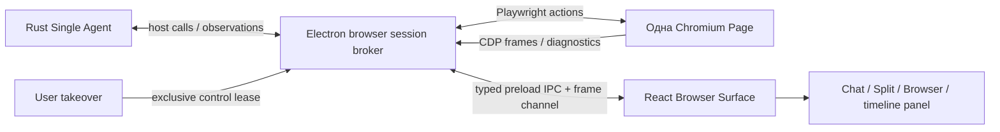

# Browser Bug Report, Live Browser Architecture и Desktop Computer Use

Дата: 2026-10-16. Ветка: `fix/agent-browser-verification`, создана от текущей `main`. Live Browser UI и Desktop Computer Use **не реализованы**.

## A. Browser Bug Report

### Исследованный запуск и полнота данных

- Analysis run: `f586ba9e-57c5-4f1e-9139-2422cb8b3b1d`, 2026-10-16 13:38:51.854–13:48 UTC.
- Generation / Rust run: `e112c822-318e-4526-9cd6-f7f95b3d0280`.
- Conversation: `ad00765b-81f3-4d78-bb12-526ad7b54639`; logical task: `aa059c9e-1e75-4989-aaba-d1ad051b08cd`.
- Model: `qwen3.6:35b-a3b-ud-q4_k_m`; Agent, Deep, web auto, 65536 context, MTP. Проект: `/media/yaroslav/DATA/Projects/test`.
- В SQLite `runtime/sqlite/local-ai-desktop.db` прочитаны conversation, messages, analysis_runs, analysis_actions, включая arguments, output, rawOutput и terminal stdout/stderr.
- Прочитан durable journal `runtime/app-data/agent-evidence/31f483d0459b964489e131713c45eebafbc5d94ae1d23082e2cc1183e7ce20a5/tasks/0043283da57d4276480e52ff7c799fa3a0a6cb95b5f8ab4ab82833abf4eee035/e112c822-318e-4526-9cd6-f7f95b3d0280/events.jsonl`: 242 записи, 60 tool messages и 60 observation-файлов. В журнале 60 model tool calls; SQLite action_count=61, хронология содержит также progress/context entries. Эти счётчики не равнозначны.
- Прочитаны соответствующие `generation.snapshot`, `attachment.vision-routing`, `llama.runtime.switch.finished`, `web.session.started`, `web.error` из application.log. Final message использован для сопоставления, а не как единственное свидетельство.
- Восстановлены все сохранённые tool arguments/results. Данных о несохранённых байтах нет: например, `npm ... | tail -5` сохранил только хвост npm-вывода; сетевой packet trace отсутствует. Полного browser trace/CDP recording для старого запуска нет.

### Фактическая последовательность

Позиции ниже относятся к `analysis_actions.position`.

| Позиция | Вызов и фактический результат |
|---|---|
| 5, 9 | `create_file`, затем `write_file`: один index.html, City / Universe / Geometry / About, Canvas, rAF, hash navigation. |
| 7, 10 | `wc -c`, `gzip -c index.html`: окончательно 12467 байт, gzip 4681. |
| 17 | `run_terminal`: `python3 -m http.server 8765`, managed task `task-23303-1`, запущен. |
| 18 | `curl -s http://localhost:8765/ \| head -5`: HTML действительно получен, но curl exit 23 из-за закрытия pipe; это не отказ HTTP-сервера. |
| 19 | `curl -s http://localhost:8765/ \| wc -c`: exit 0, 12467 байт. |
| 23 | **`web_open({url:"http://localhost:8765/"})`**: `Web-инструмент временно недоступен`, details `Local and private network access is blocked`. В application.log браузерная сессия запущена в 13:41:50.619, policy error в .620. |
| 25–39 | Node structural checks и mock Canvas; `require('canvas')`, ошибки mock/regex/rAF. Это не реальный браузер. |
| 41–43 | Чтение исходника; работоспособность страницы этим не доказана. |
| 72 | `which ...`, `require('puppeteer')`, `require('playwright')`: системный Chrome найден, проектные npm-модули не найдены. Проверки наличия **host** `playwright-core` здесь не было. |
| 74 | `npm init -y`, `npm install puppeteer`: EAI_AGAIN registry.npmjs.org, exit 1. |
| 76 | Chrome через `run_terminal`: `google-chrome --headless --disable-gpu --no-sandbox --remote-debugging-port=9222 --remote-debugging-address=127.0.0.1 about:blank`, затем curl CDP. Crashpad settings.dat read-only; **FATAL process_singleton_posix.cc: socket() failed: Operation not permitted**; затем Crashpad `ptrace: Operation not permitted`; процесс Aborted, итоговый exit 7. |
| 78–87 | Дополнительные статические проверки, task memory и итоговые 0/8 verified, implemented/not verified. |

Набор model tool calls: run_terminal 22, deliverables 17, plan 6, write_file 4, list_directory 2, create_file 2, read_file 2, task_memory 2, web_open 1, replace_text 1, delete_file 1.

### Установленная первопричина

1. **Недоставало подходящего local-project browser tool.** Rust получал шесть `web_*` schemas, host bridge работал. Но это инструменты публичного read-only research, а не проверки приложений.
2. `publicDestination` блокирует localhost, loopback/private IP; `policyBlock` запрещает file://. Route повторяет проверку для каждого ресурса/редиректа. Изображения/шрифты и не-GET/HEAD запросы также заблокированы. `snapshot()` удаляет из живого DOM scripts, nav, header и другие элементы. Переиспользовать этот research context для проверки SPA без изменения его назначения нельзя.
3. **Модель использовала имеющийся Playwright bridge.** Поэтому вывод «модель проигнорировала браузерный инструмент» неверен. Неудачный выбор произошёл позднее: установка Puppeteer и запуск Chrome в терминальной песочнице вместо отсутствовавшего local preview API. Runtime guidance также предлагал headless Chrome / Playwright scripts.
4. **Chrome в терминале — отдельное окружение.** `rust-agent/src/process/isolation.rs` запрещает ptrace, ряд namespace syscalls и AF_UNIX socket(); файловая система вне разрешённых областей read-only. Фатальный отказ — socket(), а ptrace относится к Crashpad после падения. По этим логам нельзя объявить ptrace единственной причиной.
5. **HTTP/файлы доступны:** curl получил настоящий HTML. Нет основания приписывать инцидент недоступному серверу или отсутствию Chrome.
6. Playwright запускается из Electron main (`WebBrowserService`), управляет отдельным системным Chromium через pipe и временный профиль; Rust использует host_tool_call/result JSON. Он не запускается внутри `run_terminal`.

### Исправление

Добавлен `web_project` — один host tool с actions `open`, `read`, `click`, `back`, `screenshot`, optional bounded `wait_ms`. Используется существующий `playwright-core` и общий `launchWebBrowser`, без Puppeteer, новых зависимостей или замены Rust runtime.

Пример вызовов:

```json
{"action":"open","path":"index.html"}
{"action":"click","selector":"a[href=\"#universe\"]","wait_ms":150}
{"action":"read"}
{"action":"screenshot"}
```

Для HTTP: `{"action":"open","url":"http://localhost:8765/"}`. HTML можно проверять **без HTTP-сервера и без npm-пакетов в проекте**.

Ограничения доступа:

- Schema выдаётся только при выбранном проекте и web auto; web off проверяется и на host стороне.
- Первое открытие требует существующий approval callback. Нет UI/решения — `PERMISSION_DENIED`, браузер не запускается. Диалог явно разрешает доступ к указанному проекту или origin до конца текущего запуска.
- Один проект и один origin на run. Новое поколение требует нового разрешения. Произвольный host root из аргументов модели не принимается.
- Статические файлы проекта выдаются через перехваченный synthetic HTTPS origin. file:// не используется. Нет прослушивающего порта или directory listing. Разрешён ограниченный список web-расширений, скрытые пути/metadata/symlinks запрещены. Используется projectPath и проверка открытого файлового дескриптора через /proc на Linux; FIFO/device не читаются. Не более 4 MiB на ресурс.
- HTTP только `localhost` / `127.0.0.1` с явным нестандартным портом; соединение закреплено на 127.0.0.1 без DNS, системного proxy, credentials или cookies. IPv6 localhost в этой версии не поддерживается. Разрешение относится к origin, а не доказывает принадлежность процесса этому проекту; текст диалога показывает точный origin.
- Все HTTP requests и redirects ограничены тем же origin, GET, 256 запросами и ограничением общего объёма. Запрещены WebSocket, service workers, WebRTC, downloads, popups; dialogs dismiss. Чужая main-frame navigation закрывает страницу. Нет model-supplied evaluate, upload или доступа к preload/Node.
- Read извлекает DOM без удаления узлов. Ошибки pageerror/console и blocked requests ограничены по числу/длине. Повторный open сбрасывает диагностику, позволяя перепроверить исправления.
- До 8 PNG viewport screenshots на run в writable application cache/browser-captures, вне bundle и проекта. В контекст идут путь и metadata, а не base64. Retention пока соответствует обычному cache, отдельная политика удаления скриншотов остаётся будущей задачей.
- AbortSignal закрывает context/browser и прерывает HTTP, включая позднее завершение launch. Host response deadline учитывает approval UI (330 секунд); Rust cancellation polling и существующие tool-call/loop budgets сохраняются.
- Rust учитывает host browser capability и регистрирует ограниченное browser evidence по фактическому static source_path. Скриншот и произвольный HTTP-сервис не дают автоматического file-scoped verification. Успешный snapshot означает только наблюдённый DOM/runtime, не исчерпывающую проверку поведения или внешнего вида.

GET не гарантирует отсутствия серверных побочных эффектов; именно поэтому loopback требует разрешения. Application routing — ограничение ресурсов, а не гарантия защиты от уязвимости самого Chromium. Параметры запуска унаследованы от существующего browser service; терминальная/AppArmor/seccomp политика не ослаблялась.

### Реальные проверки и найденный дефект исходного сайта

`scripts/project-browser.test.mjs`: реальный системный Chrome, реальный временный loopback HTTP server. Проверены HTML, HTTP localhost, DOM/nav preservation, click/hash/back, console error и exception, валидный PNG, origin/redirect/method blocking, hidden paths, symlink escape, approval denial, unavailable launcher, отмена загрузки и позднего launch. Это не mock browser.

`scripts/agent-web-browser.test.mjs`: существующий research browser regression прошёл в реальном Chromium; HTTP transport/provider pages в этом тесте fixture, без публичной сети. `rust-agent-runtime.test.ts`: протокольный bridge, selected-project schema, web off, отсутствие approval transport, Stop и прежние регрессии; это протокольный fixture, не реальный Qwen inference.

Дополнительно из write_file восстановлен точный index.html в `/tmp`, SHA256 `f64ddde4f6fe87bf03eddd927b615a9486d4440a4ba848bca6e10d46c86d7fa3`. 12467 байт; `gzip -c index.html`=4681, `gzip -nc`=4670 (разница — имя файла в gzip header). Реальный Chromium открыл NEXUS, прочитал четыре ссылки, выполнил все четыре hash-перехода и создал PNG. **При этом браузер обнаружил runtime error: `Failed to execute 'fillRect' on 'CanvasRenderingContext2D': 4 arguments required, but only 3 present.`** В исходнике строка 74 содержит `g.fillRect(RN()*W,RN()*sy,RN()*1.5+.5)`. Анимация не считается работающей; исходный проект не исправлялся в рамках изменения инфраструктуры.

Отдельный временный Electron main fixture запустил тот же ProjectBrowserSession: реальный Chrome, NEXUS DOM, тот же Canvas error и PNG — PASS. Это проверка main-process окружения, не полного UI и не packaged приложения.

Проверки сборки: `npm run build`, TypeScript, затронутый новый browser module и script через ESLint; Rust lib suite 279 тестов. Внутри Codex sandbox девять существующих process/isolation тестов не прошли; при повторе вне неё все 279 прошли. Первый Chromium запуск внутри Codex также блокировался setsockopt; браузерные PASS получены вне Codex sandbox, без изменения политик приложения. В существующем runtime bridge test file ESLint сообщает прежний unused `_` в permission transport regression; новая проверка его не добавляет.

### Production и оставшиеся ограничения

- `playwright-core` уже production dependency; dist/** и зависимости входят в package, asar=false; Rust бинарник включён через extraResources. Screenshot/cache путь writable и не зависит от cwd/bundle.
- Browser resolver по-прежнему ищет системные `/usr/bin/google-chrome`, `/usr/bin/chromium`, `/usr/bin/chromium-browser`. Chromium не включён в .deb и не объявлен обязательной deb dependency. На машине без него будет явная ошибка, а не автоматическая установка/обход. Windows browser discovery не реализован; текущая поставка ориентирована на Linux.
- Новый production .deb не собирался/не устанавливался; packaged lifecycle и Windows browser execution не считаются проверенными. На произвольных версиях системного Chrome Playwright compatibility требует отдельного release smoke.
- WebSocket/HMR, POST/backend mutations, cross-origin API, login, file upload, произвольные JS assertions и заполнение форм не входят в это минимальное исправление. Для статического четырёхстраничного сайта они не нужны. Navigation/DOM проверяются; полного Computer Use API пока нет.
- HTTP localhost проверен реальным сервером; конкретный managed server из старого запуска уже завершён. Его прежняя доступность установлена по curl/logs, а не приписана новому тесту.
- Свежий автономный Qwen run не запускался; schema/prompt/bridge исправлены, но поведенческая надёжность модели требует последующего acceptance run.

### Vision

По `llama-runtime-policy.ts` Qwen3.6 имеет vision profile и projector, но `visionWithMtp=false`. `llama-launch-config.ts` не передаёт mmproj при MTP; backend.supportsVision требует активную модель и visionEnabled. Исследованный запуск действительно был MTP. Следовательно, **в его конфигурации native image understanding недоступно**. При MTP OFF и корректном установленном projector pipeline умеет передавать image_url для пользовательских image attachments через Rust/provider; live quality inference в этом исследовании не выполнялся. Сохранённый screenshot_path сам по себе не становится image attachment: автономная передача browser screenshots vision-модели пока отсутствует. DOM/browser execution и vision — разные подтверждённые возможности.

## B. Live Browser Architecture — только предложение

### Рекомендация и варианты

Для первого этапа рекомендуется **A + C**: существующая Playwright Page + CDP screencast в React, без второго экземпляра страницы. Playwright предоставляет [CDPSession](https://playwright.dev/docs/api/class-cdpsession), Chromium — [Page.startScreencast / screencastFrame / screencastFrameAck](https://chromedevtools.github.io/devtools-protocol/tot/Page/). Это архитектурный вывод по текущему коду, не реализованный прототип.

| Критерий | A. Playwright + screenshots/frames | B. Electron WebContentsView | C. CDP observation существующей Page | D. Electron offscreen / отдельное headed окно |
|---|---|---|---|---|
| Electron/Rust | Host JS сохраняется; Rust JSON tools | Electron main native view; нужен другой browser adapter | Существующий host + CDPSession | Offscreen требует adapter; headed Playwright переиспользуется |
| Тот же браузер | Да, кадры того же pageId | Только если агент управляет именно этим webContents | Да, подключение к тому же target/session | Да при управлении тем же offscreen/headed target |
| Runtime reuse | Почти полный | Нельзя вмонтировать произвольный external Chrome Page в WebContentsView | Максимальный; надстройка над A | Offscreen — частичный; headed — полный |
| Click/scroll/type/nav | IPC → Playwright actions | Native input + webContents/debugger | Playwright actions/CDP Input | Оба возможны, разные adapters |
| Указатель/действия | Overlay из инструментальных событий | MouseMove/overlay отдельно | Input events + overlay поверх кадра | Аналогично; нельзя обещать курсор в screenshot |
| Localhost | Существующий scoped transport | Перенести policy в session/webRequest/protocol | Наследует политику управляемой Page | Нужна та же policy |
| RAM/VRAM/CPU | Один Chrome + Electron; кодирование/копии кадров, CPU/RAM | Electron renderer, без второго Chrome; native composition экономит копии | Та же память, что A; screencast дешевле частого PNG polling | Offscreen texture может быть эффективнее, но сложнее; headed + host UI остаются |
| Изоляция | Отдельный ephemeral context, host broker | nodeIntegration=false, contextIsolation=true, sandbox=true, отдельная непостоянная partition | CDP только внутри доверенного main/worker, без exposed port | Offscreen — Electron boundaries; headed — Chrome boundaries |
| Ручной takeover | Queue/lease, UI input forwarding | Native input удобнее, всё равно ownership lease | Тот же queue/lease | Headed напрямую удобно, но вне чат-панели |
| Packaging | Зависит от системного Chrome, как сейчас | Chromium уже в Electron; потребуется тест версии API | Поддержка CDP конкретным Chrome; не открывать TCP debugger | Offscreen API/version/GPU smoke; headed — текущая зависимость |
| Сложность | Низкая/средняя; PNG polling для spike | Высокая миграция, native bounds/z-order/DPI | Средняя, backpressure/frame ACK/reconnect | Offscreen высокая; отдельное окно низкая, но не удовлетворяет встроенному UI |

[WebContentsView](https://www.electronjs.org/docs/latest/api/web-contents-view) отображает Electron webContents и может принять существующий **Electron** webContents, но не external Playwright Chromium Page. Второй `loadURL` рядом с Playwright создаст другую сессию, даже с теми же cookies. [connectOverCDP](https://playwright.dev/docs/api/class-browsertype#browser-type-connect-over-cdp) имеет меньшую fidelity, чем Playwright protocol; подключение ко всему Electron через открытый debug port не рекомендуется. Нужен ограниченный adapter к выделенному target или полноценная миграция runtime, если позднее выберут B. Версии документации latest необходимо сверить с закреплённым Electron 39 перед реализацией.

[Electron offscreen rendering](https://www.electronjs.org/docs/latest/tutorial/offscreen-rendering) предоставляет bitmap/shared texture варианты, но переносит источник кадров в Electron. iframe не подходит для показа той же Playwright сессии, ограничивается CSP/X-Frame-Options и создаёт отдельный document. Electron также [не рекомендует webview tag](https://www.electronjs.org/docs/latest/api/webview-tag) для нового решения.

### Схема и UI lifecycle



BrowserSessionManager принадлежит host, хранит sessionId, conversationId/logicalTaskId/runId, pageId, approved scope, viewport и action queue. React mount/unmount меняет только подписку и размещение BrowserSurface, не жизненный цикл Chromium. Chat скрывает поток кадров, но агент продолжает работу; Split показывает фиксированный chat subtree слева и resizable BrowserSurface справа; Browser расширяет ту же поверхность. Изменение ширины display по умолчанию масштабирует кадр; изменение реального viewport — отдельная команда с событием, иначе resize невольно меняет проверяемую верстку.

`App.tsx` уже содержит conversationRef, followStream и requestAnimationFrame scheduling автоскролла. Сохранить эту ветку mounted, прежние ключи сообщений и AgentTimeline; display-mode хранить отдельно от chat state. Frame updates не должны попадать в messages/store/SQLite или провоцировать рендер всей ленты. Inline раскрывающаяся панель в AgentTimeline привязывается к activityId/sessionId/pageId и подписывается на тот же источник. Закрытый run показывает только сохранённый screenshot/status; просмотр истории не создаёт новый браузер и не выдаёт старый кадр за live. Несколько подписчиков могут видеть один frame stream; интерактивный controller только один.

Сначала session lifecycle = run, как сейчас. Переживание окончания run/возобновление logical task — отдельное согласованное изменение с TTL, idle cleanup и повторной авторизацией. Stop прерывает текущую очередь и browser operations; скрытие панели и unsubscribe не вызывают Stop. Reload renderer не должен перезапускать активный browser. Browser crash отображается как crash с потерей состояния, без скрытого повторного выполнения действий.

### Модули будущей реализации

- `src/main/web/project-browser.ts`: session manager, action queue, CDP observer; `web-tools.ts` — общий launch adapter.
- `src/main/services/rust-agent-runtime.ts`, `rust-agent/src/tools/web.rs`, `rust-agent/src/agent/loop_runtime.rs`: lifecycle/action metadata и отмена, без замены Single Agent orchestration.
- `src/main/ipc/` и `src/preload/index.ts`: строго типизированные authorized subscribe/input/control IPC, проверка sender и session ownership.
- `src/shared/types.ts` либо отдельный browser-events.ts: contracts/capabilities.
- `src/renderer/App.tsx`, `components/AgentTimeline.tsx`, новый BrowserSurface и layout styles: представления/inline panel. Удержать текущий scroll subtree.
- Renderer store: layout и lightweight session metadata; кадры отдельным MessagePort/локальным surface state. Database — только session/action/screenshot references, не непрерывное видео.
- `packaging/`, release smoke scripts: browser discovery/version, writable cache, IPC cleanup, Linux/Windows matrix.

### Предлагаемый API (не добавлен в код)

Общий envelope: `{sessionId, conversationId, logicalTaskId, runId, pageId, seq, timestamp, actionId?}`. Host назначает идентификаторы; renderer не выбирает произвольный CDP target или путь.

| Событие | Payload |
|---|---|
| browser.session | state: starting/ready/closed/crashed, capabilities, approvedScope |
| browser.navigation | url, title, loading, canGoBack, blockedReason? |
| browser.frame | frameId, viewport, scale, deviceScaleFactor, encodedBytes/transferable buffer |
| browser.action | queued/running/completed/failed/cancelled, actor agent/user, kind, safe target, pointer x/y |
| browser.diagnostic | JS/console/network error, bounded/redacted details |
| browser.control | owner agent/user, leaseId, epoch, pendingHandoff |
| browser.screenshot | artifactId, mime, dimensions, authorized artifact reference |

Commands: subscribe/unsubscribe, acknowledgeFrame, requestControl/releaseControl, input(mouseMove/down/up/wheel/key/text), navigate/back, setViewport, screenshot. Никаких raw CDP/evaluate/file paths через renderer IPC. Input содержит lease epoch, actionId и viewport revision: устаревшие координаты/команды отвергаются. При takeover завершить/отменить текущий action, остановить выдачу новых browser actions агенту, не уничтожая task; вернуть управление явно. Текстовый ввод/credentials нельзя безусловно писать в историю.

Начать с 5–10 fps, 1280×900, JPEG для наблюдения, PNG для evidence; это целевые параметры, не измеренный benchmark. Не более одного-двух кадров in flight, ACK CDP после принятия, drop старых кадров, без неограниченной очереди. При скрытой панели остановить только capture/subscription; page остаётся активной. Масштабирование/scroll coordinates и IME/keyboard layout требуют отдельных тестов. RAM/VRAM и encode cost измерять вместе с загруженной LLM; обещать фиксированный расход до profiling нельзя.

### Безопасность и трудоёмкость

Нужны sender validation, run/conversation ownership, отдельный ephemeral profile, исходные origin approvals на каждом redirect/resource, запрет Node/preload в странице, permissions для download/upload/clipboard/OS device APIs, prompt-injection boundary (DOM — недоверенные данные), секреты и retention кадров. Remote debugging TCP не открывать на доступном интерфейсе. [Electron security guidance](https://www.electronjs.org/docs/latest/tutorial/security) остаётся базой для любого Electron-варианта.

Оценка одного разработчика при существующем browser tool: spike и измерения 2–3 дня; MVP A+C с Chat/Split/Browser, frames, status и Stop — 7–12 рабочих дней суммарно. Полная версия с inline history, user takeover/input/IME, crash recovery, bounded persistence, security и packaged regression matrix — 4–7 недель. Вариант B с переносом управления и политик — ориентировочно 6–10 недель; перед ним обязательный совместимый с Electron 39 spike. Это инженерные оценки, не гарантированный календарный срок.

## C. Desktop Computer Use Feasibility — будущее развитие

Возможно управление Qt, GTK, Swing, C#/Win32 и Electron без зависимости от языка приложения. Язык не определяет доступность: важны OS window/capture/input APIs, accessibility provider, privilege level и характер отрисовки. Custom canvas/OpenGL controls часто не имеют полезного accessibility tree.

Предлагаемая архитектура: тот же Rust single-agent → typed host DesktopSessionBroker → ограниченный OS adapter/helper. Он получает явное разрешение на окно/desktop session, выдаёт capture и accessibility snapshot, исполняет input по очереди с ownership lease. Desktop helper должен быть отдельной доверенной capability, а не обходом запрета ptrace/AF_UNIX в терминале. Browser DOM и Desktop accessibility — разные adapters; общий ObservationSurface может переиспользовать кадры, курсор, масштабы, takeover, Stop и diagnostics. Произвольный доступ ко всему рабочему столу не наследуется от разрешения на local browser.

| Платформа | Захват | Input и Accessibility | Ограничения |
|---|---|---|---|
| Windows | Windows Graphics Capture для окна; DXGI Desktop Duplication для output/монитора | SendInput и UI Automation COM; semantic Invoke/Value patterns предпочтительнее координат | UIPI/integrity levels, foreground/focus, UAC secure desktop, protected content, закрытая/заблокированная session; elevated agent по умолчанию недопустим |
| Linux X11 | XComposite/XDamage или capture через Electron desktopCapturer | XTest; AT-SPI2 через D-Bus | X display auth часто даёт слишком широкую власть, window focus и координаты нестабильны, minimized windows и compositor-specific capture; нет универсальной безопасной window-scoped input capability |
| Linux Wayland | ScreenCast portal → PipeWire, выбранный пользователем источник | RemoteDesktop portal, при поддержке ConnectToEIS/libei; AT-SPI отдельно | Нельзя предполагать глобальную инъекцию или перечисление окон; compositor/portal backend различаются, требуется OS consent, возможны revocation, отсутствие функций и ограничение источников |

Основания: [Windows UI Automation](https://learn.microsoft.com/en-us/windows/win32/winauto/uiauto-uiautomationoverview), [SendInput/UIPI](https://learn.microsoft.com/windows/win32/api/winuser/nf-winuser-sendinput), [Desktop Duplication](https://learn.microsoft.com/en-us/windows/win32/direct3ddxgi/desktop-dup-api), [XTEST](https://xorg.freedesktop.org/archive/current/doc/libXtst/xtestlib.html), [AT-SPI](https://gnome.pages.gitlab.gnome.org/at-spi2-core/libatspi/), [ScreenCast portal](https://flatpak.github.io/xdg-desktop-portal/docs/doc-org.freedesktop.portal.ScreenCast.html), [RemoteDesktop portal](https://flatpak.github.io/xdg-desktop-portal/docs/doc-org.freedesktop.portal.RemoteDesktop.html). Это API-возможности, не выполненные в этом задании platform smoke tests.

[Electron desktopCapturer](https://www.electronjs.org/docs/latest/api/desktop-capturer) подходит для начального capture adapter; на PipeWire возвращается выбранный источник, а не гарантированный полный список окон. Capture само по себе не даёт input permission. Для remote desktop portal input/capture consent и session lifecycle следует вести совместно.

Vision-модель нужна для произвольных интерфейсов, где нет семантики, распознавания layout/иконок и поиска по пикселям. При хорошем accessibility tree часть операций возможна текстовой моделью, но визуальную корректность это не доказывает. Нужны accurate coordinate grounding, resize/DPI awareness, observation после действия и отдельный verdict; Qwen3.6+MTP в текущей конфигурации для такого vision цикла не подходит. Нельзя передавать скриншот и исполнять координаты без явной проверки текущего frame/lease.

Границы: allowlist выбранных окон, явное начало/конец OS consent, аварийный Stop независимо от модели, запрет скрытых привилегированных действий и ввода секретов без разрешения, redaction/retention, видимый текущий target, аудит действия. Кроссплатформенный reliable Computer Use — существенно сложнее browser tools. Оценка: ограниченный MVP одного OS backend 3–5 недель; Windows + X11 + Wayland с accessibility, takeover, packaging, permissions и тестами разных DE — 10–16+ недель. Управление «любым приложением» гарантировать нельзя.

## D. Git и воспроизведение

Ветка `fix/agent-browser-verification` создана от исходной `main`; merge, commit и переключения базы не выполнялись. Изначально был только untracked `runtime/`; в изменения он не включён. При первом запуске существующих tests logger добавил fixture-записи в его application.log; только этот точно установленный суффикс сохранён в `/tmp/lad-browser-test-log-suffix.txt` и удалён из исходного журнала. Последующие tests используют отдельный runtime в /tmp. SQLite и пользовательский проект не менялись.

Изменены:

- `src/main/web/project-browser.ts` — новый scoped preview tool/session.
- `src/main/web/web-tools.ts` — общий browser launch и описание research/local distinction.
- `src/main/services/rust-agent-runtime.ts` — schema/dispatch, approval, run lifecycle/Stop.
- `rust-agent/src/tools/web.rs` — host registration и deadline для approval.
- `rust-agent/src/agent/loop_runtime.rs` — capability/guidance и scoped browser evidence с regression test.
- `rust-agent/src/agent/verification.rs` — guidance к host browser вместо terminal workaround.
- `src/main/services/rust-agent-runtime.test.ts` — protocol regression для local preview.
- `src/main/services/agent-workspace.ts` и `.test.ts` — согласованная диагностика enabled tools и проверки scope.
- `scripts/project-browser.test.mjs` — реальный browser/security/cancellation regression.
- Этот отчёт.

Воспроизведение (browser/process tests требуют обычного host-окружения, не ограниченной Codex песочницы):

```sh
npm run build
node scripts/project-browser.test.mjs
node scripts/agent-web-browser.test.mjs
LOCAL_AI_RUNTIME_ROOT=/tmp/lad-browser-regression node dist/main/services/rust-agent-runtime.test.js
LOCAL_AI_RUNTIME_ROOT=/tmp/lad-browser-regression node dist/main/web/web-tools.test.js
LOCAL_AI_RUNTIME_ROOT=/tmp/lad-browser-regression node dist/main/web/public-network.test.js
LOCAL_AI_RUNTIME_ROOT=/tmp/lad-browser-regression node dist/main/models/model-capabilities.test.js
cargo test --locked --manifest-path rust-agent/Cargo.toml --lib
git diff --check
```

Изменения оставлены незакоммиченными для review; существующий untracked runtime/ сохраняется отдельно. Live Browser/desktop UI, Multi-Agent Mode и глобальные политики безопасности не изменялись.
