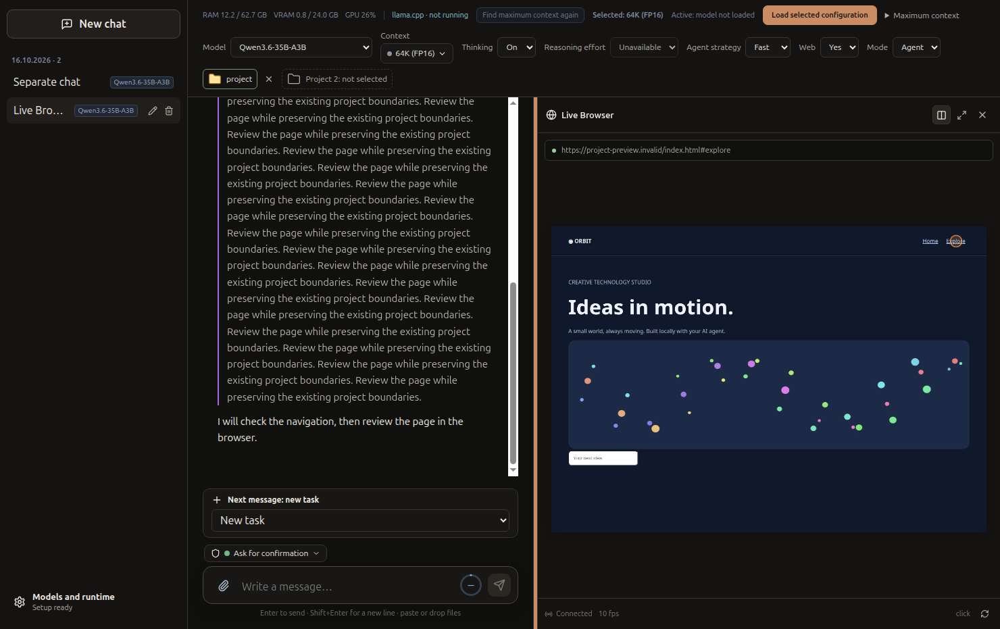
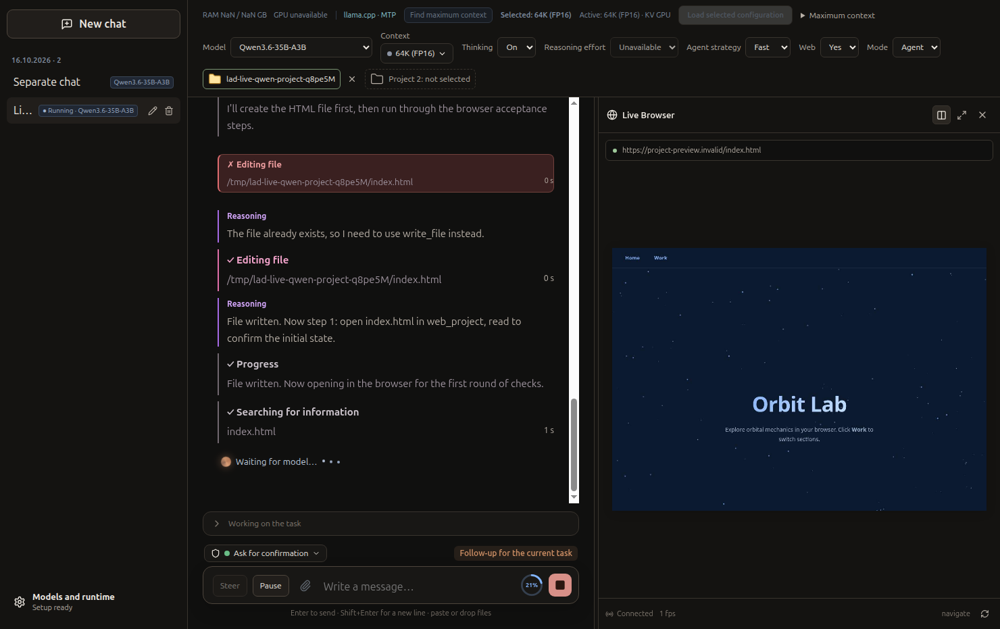

# Live Browser

Реализовано в `feature/live-browser` от `main` (`a39870c`). Версия приложения остаётся 0.2.1. Это разработка функции, без публикации релиза.

## Как пользоваться

В Agent Mode включите Web и выберите проект. Попросите агента создать или исправить страницу и проверить её через `web_project`. После разрешения доступа браузер появляется справа автоматически.

Разделитель меняет ширину панелей, кнопки в заголовке переключают Split View / Browser Expanded / Chat Only. Закрытие панели скрывает только просмотр. Кнопка Live Browser над чатом возвращает текущую страницу; ручной выбор запоминается для этого чата до перезагрузки интерфейса. На узком окне панели располагаются вертикально. Чат, история инструментов и автоскролл остаются существующими компонентами.





## Общая сессия и передача кадров

```text
Rust Agent → существующий host bridge → ProjectBrowserSession → Playwright Page
                                                       │             │
                                                 actions / URL   CDP screencast
                                                       └──────┬──────┘
                                                         LiveBrowserHub
                                                              │ IPC
                                                      preload → React canvas
                                                              │ ACK после draw
                                                              └────────→ Hub → CDP
```

Hub получает **существующий Page** через необязательный observer. Он не запускает Chromium, не открывает второй context/page и не вызывает `web_project.screenshot`. Открытие, DOM, JS/console errors и PNG-снимки продолжают работать через существующий браузерный инструмент.

Поток использует [Playwright CDPSession](https://playwright.dev/docs/api/class-cdpsession) и [Page.startScreencast / screencastFrameAck](https://chromedevtools.github.io/devtools-protocol/tot/Page/). Кадры JPEG quality 65, максимум 1280×900, everyNthFrame=2; Hub дополнительно ограничивает отправку примерно 12 FPS. Для неподвижной страницы Chromium может не выдавать новых кадров: 0 FPS тогда не означает отключение.

Одновременно ожидает подтверждения только один отправленный кадр. Renderer декодирует JPEG в ImageBitmap, рисует canvas, вызывает `close()` и возвращает ACK. CDP credit возвращается после ACK либо через секунду, если renderer перестал отвечать. Лишние/слишком большие (>2 MiB base64) кадры отбрасываются с подтверждением. В renderer допускается только одно декодирование. Бесконечной очереди кадров нет.

Существующий viewport 1280×900 масштабируется целиком под панель; resize панели не меняет layout проверяемого сайта. При скрытой панели, другом чате или скрытом окне screencast останавливается. Страница и агент продолжают работу.

## Действия, события и модули

`web_project` дополнен `fill`, `scroll`, `forward`, `reload`. Клик/ввод показывают краткий маркер в области элемента, остальные действия — подпись активности. Событие приходит после успешного действия Playwright; вводимый текст не передаётся отдельным событием. Положение маркера масштабируется вместе с viewport. Это индикатор целевого элемента, а не запись физического курсора ОС.

Изменения файлов видны после `reload` или повторного `open` в том же Page. Автоматического watcher/reload нет: это исключает перезагрузки посреди проверки и не требует второго dev server.

| Модуль | Назначение |
|---|---|
| `src/main/web/live-browser.ts` | CDP, ограничения потока, владелец окна, lifecycle |
| `src/main/web/project-browser.ts` | Observer и реальные действия браузерного инструмента |
| `src/main/services/rust-agent-runtime.ts` | Передача observer, ожидание закрытия браузеров в finally |
| `src/main/ipc/register-ipc.ts`, `src/preload/index.ts` | Узкий IPC-мост наблюдения |
| `src/shared/live-browser.ts` | Типы состояния, кадров, событий |
| `src/renderer/components/LiveBrowser.tsx`, `App.tsx`, `styles/app.css` | Панель, canvas, режимы, resize |

API: `watch(conversationId|null, visible)`, `acknowledge(sessionId, sequence)`, `onEvent(listener)` с отпиской. События — `state` (loading/live/ended/error, URL, action/error) и `frame` (JPEG, размеры, sequence). Оба содержат conversationId, generationId, sessionId. Произвольные CDP-команды и управление страницей из renderer отсутствуют.

## Жизненный цикл и безопасность

Подписка привязана к WebContents и conversation. При смене чата canvas очищается до отрисовки, старое декодирование не может нарисовать кадр новой сессии. Новый запуск получает новый sessionId. Renderer reload и кнопка переподключения подписываются на существующий Page. После потери CDP возможна повторная привязка без нового браузера.

Stop отменяет действия и закрывает браузер через прежний abort-механизм. Завершение запуска также закрывает context/browser; остаётся последний кадр с соответствующим статусом. Хранятся максимум восемь последних сессий на окно, только в RAM. Закрытие окна снимает подписки/CDP/таймеры и освобождает записи. Завершённую страницу нельзя оживить кнопкой просмотра — нужен новый вызов агента.

Сохранены project scope, отдельное разрешение origin, проверки redirect, запреты внешних/private адресов вне разрешённого origin, file://, записи через HTTP, WebSocket и произвольного JS evaluation. Публичные web tools не изменены. Панель только наблюдает, не расширяет полномочия агента. Она не использует iframe или WebContentsView с независимой навигацией.

Изображения не передаются в LLM, SQLite, историю или task memory. Vision, inference, MTP, planning, project references и Rust agent loop не изменены. Новых зависимостей нет; используется прежний host Chromium. Пользовательские runtime/SQLite/модели не затронуты. Старые эксперименты планировщика не включены.

## Проверки 16 октября 2026

Окружение: Linux, Node 24.19.0, Electron 39.8.10, Playwright 1.63.0, Google Chrome 150.0.7871.181.

Использованы настоящий Chromium, настоящий Electron с production renderer/preload/IPC и изолированными временными данными. Ограничения среды Codex потребовали запускать GUI/browser-тесты вне инструментальной sandbox; настройки защиты приложения не менялись. Графический fixture отключает hardware acceleration только для воспроизводимого теста.

| Проверка | Результат |
|---|---|
| Реальный Chromium, общий Page | Один browser/context/page; HTML и разрешённый HTTP loopback, меняющиеся Canvas-кадры |
| Действия и изменения | Click/hash/back/forward/fill/scroll; изменение файла + reload в том же Page |
| Поток/lifecycle | ACK/backpressure, скрытие/возврат, разные чаты/окна, новый run, CDP detach/reconnect, crash и unavailable browser |
| Stop/security | Отмена во время navigation/launch/click; approvals, redirects, методы HTTP, file/symlink и origin ограничения |
| Настоящий Electron | Split/drag/Expanded/Chat Only, renderer reload, чат не сбрасывается, scroll, 980×760 и stacked 860×900, ошибок renderer нет |
| Цвета | Тёмная палитра и инъекция светлых theme tokens; отдельного переключателя темы в текущем приложении нет |
| Qwen3.6-35B-A3B UD-Q4_K_M | Реальный llama.cpp + Rust tool loop, context 65536, draft-mtp max2, без vision |
| Регрессии | Rust host bridge, Agent workspace, logical-task runtime, terminal lifecycle, Stop/history, обычный Chat tool loop, публичные web tools |
| Общие проверки | TypeScript, Electron build, ESLint: 0 errors, 2 прежних warnings; Rust: 279 unit + 99 integration passed, 1 существующий ignored |

Финальный Qwen-сценарий занял **61.315 с** после отправки задания (загрузка модели отдельно). Агент переписал страницу Orbit Lab, открыл её, нажал ссылку, заполнил поле, прокрутил страницу, изменил заголовок, выполнил reload и проверил DOM. UI получил **181 кадр**, 99 различных среди первых 100, **один sessionId**. При скрытой панели продолжались реальные tool events, после открытия показывалась та же сессия. Все восемь вызовов `web_project` успешны; сначала был один отказ `create_file` из-за уже существующего fixture-файла, модель восстановилась через `write_file`. Это не проверка эстетического качества сайта и не vision.

В прямом тесте — **10 FPS**, 52 кадра / 48 различных за весь сценарий. В минутном Electron Canvas-тесте все 12 измерений показывали **10 FPS**. Renderer RSS: **206–219 MiB**, Electron main: **234–262 MiB**. После первого измерения `percentCPUUsage` main был 0.22–0.39, renderer 0.59–0.65 (показатель Electron; это не суммарная нагрузка системы). Эти числа включают обычный UI и относятся к одному Linux fixture; внешние Chromium/GPU/llama.cpp в них не учтены. VRAM отдельно не измерена. До освобождения ImageBitmap renderer за минуту вырастал до 764 MiB; этот вариант заменён и повторно проверен.

Воспроизведение:

```bash
npm run test:live-browser
LOCAL_AI_TEST_LLAMA_SERVER=/path/to/llama-server \
LOCAL_AI_TEST_QWEN_GGUF=/path/to/Qwen3.6-35B-A3B.gguf \
npm run test:live-browser:qwen
```

Qwen-harness использует собственный порт 18081 и завершает только свой server/Electron. Пользовательские настройки не меняет. Результаты и скриншоты сохраняются в игнорируемом `artifacts/live-browser/`; тестовые временные данные не заменяют пользовательский runtime.

## Ограничения и следующий этап

Режим наблюдения: без ручного управления, аудио, vision и автоматического file watcher. Просмотр доступен для `web_project`, не публичного браузера поиска. JPEG до 12 FPS подходит для наблюдения, но не заменяет видео 60 FPS. CDP screencast — экспериментальный Chromium API; отказ потока отображается отдельно и не требует переносить agent loop.

Проверена Linux development-сборка с установленным Chrome. Новый production installer, Windows и многочасовой стресс-тест не проверялись. Минутный замер не доказывает отсутствие всех долгосрочных утечек. Следующий этап — длительный тест в упакованном приложении, оценка полной нагрузки Chromium/GPU и затем отдельное проектирование ручного перехвата управления; vision остаётся независимой задачей.
