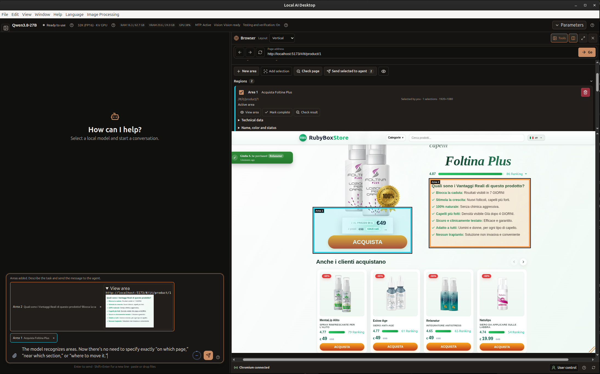
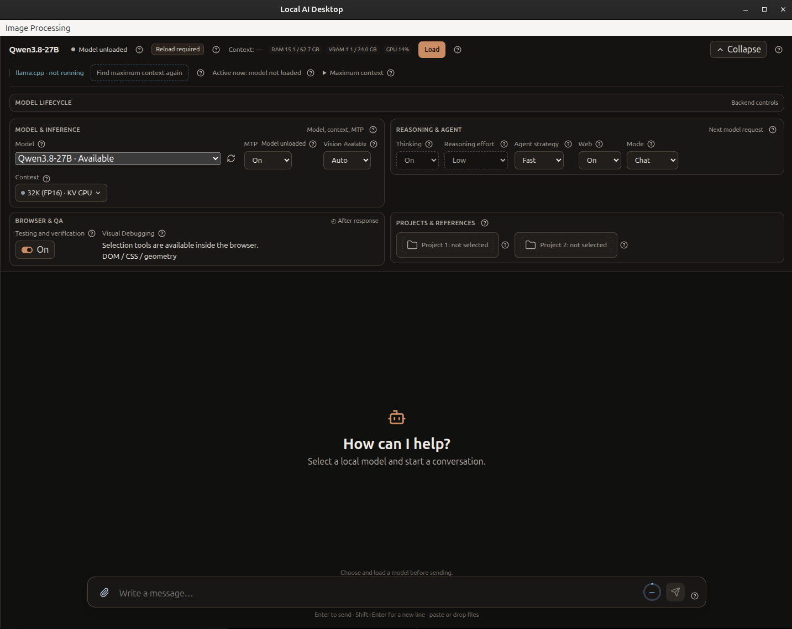
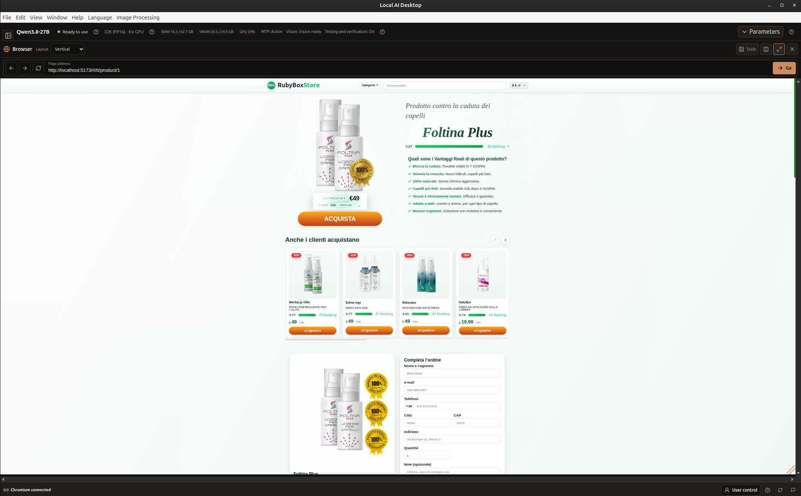

# Local AI Desktop v0.3.0

**Experimental Alpha · 29 октября 2026 года**

В v0.3.0 появился Browser Workspace рядом с Chat и Agent, выбор областей веб-страницы и более надёжная работа с длинными текстовыми документами. Также улучшены задачи Agent, настройка моделей и восстановление после ошибок.

## Посмотреть демонстрацию


**Постановочная демонстрация. Без реального запуска модели.** Ответы AI и часть показаний GPU в ролике подготовлены заранее: это не результаты работы модели в реальном времени и не benchmark.

## Browser Workspace

Откройте локальный веб-проект рядом с Chat или Agent и просматривайте страницу внутри приложения. Запустите сервер разработки привычным способом, например `npm run dev`, и введите локальный адрес в Browser Workspace. Приложение не обязательно запускает этот сервер самостоятельно.

Можно выбрать размер viewport, в том числе мобильный или настольный, изменить масштаб страницы и preview, а также расположение браузера. Сверните второстепенные панели или разверните браузер на большую часть окна. Browser Workspace в первую очередь предназначен для локальных проектов. Это не защищённый браузер для произвольного веб-сёрфинга; правила навигации не гарантируют блокировку всех внешних сайтов.


## Выберите области для изменения

Нажмите **New area** и выделите нужную часть страницы. Кнопка **Add selection** добавит ещё одну область — например, элемент, который нужно переместить, и место, куда его следует перенести. Перед отправкой запроса можно проверить и изменить выбранные области.

Выделите часть страницы и опишите желаемый результат. Несколько областей помогают показать, какой контент нужно переместить и куда.

Выбор передаёт Chat или Agent сведения об областях, а при наличии — связанные элементы страницы и исходники проекта. Текстовая модель не видит пиксели браузера напрямую. Передача изображения зависит от поддержки Vision моделью и настроек приложения; DOM и исходники помогают найти код, но не доказывают содержимое каждого выделенного пикселя.



## Чтение больших текстовых документов

Прикрепите поддерживаемый текстовый файл, например большой `.txt` (размер каждого вложения — до 25 МБ), попросите Chat прочитать его полностью и наблюдайте за прогрессом. Длинный документ обрабатывается последовательно, а подтверждённый прогресс сохраняется, чтобы продолжить чтение после прерывания. Затем можно попросить пересказ или задать дополнительные вопросы. Результат зависит от модели: последовательная обработка не гарантирует, что она сохранит или вспомнит каждую деталь.

Среди текстовых вложений поддерживаются `.txt`, `.md`, `.json`, `.csv`, `.log` и текстовые файлы исходного кода и конфигурации. Для других форматов используются отдельные способы извлечения; не следует считать, что сценарий чтения целого документа одинаково работает со всеми типами файлов. Для сканов PDF нужен OCR, которого в приложении нет.


Чтобы освободить место для задачи, можно свернуть историю бесед и другие второстепенные панели.

## Улучшения Chat и Agent

Chat получил инструменты только для чтения вложений и, если выбран проект, поиска по его файлам и чтения ограниченных фрагментов исходников. Также можно исследовать уже открытую страницу Browser Workspace. Изменение файлов, команды терминала и управление браузером остаются действиями Agent. Улучшены последовательное чтение больших вложений, сохранение прогресса и восстановление после Stop, compaction или перезапуска.

Agent Runtime V2 сохраняет планы и результаты задач, пока работа продолжается в других чатах. Восстановление после повторяющихся действий ограничено; при проверке различаются слова Agent и результаты, подтверждённые свежими данными. Завершённый план сам по себе не доказывает, что всё работает: проверяйте изменения и результаты проверок.

Длинный ответ Chat может продолжаться в нескольких запросах к модели в пределах бюджета оркестрации до 50K выходных токенов. Это не обещание, что модель выдаст такой объём. Context Monitor показывает измеренное использование и активность; compaction надёжнее сохраняет исходный запрос и прогресс чтения.

## Настройка моделей и интерфейс

Стало понятнее, как работают профили моделей, обновление доступности GGUF, настройки контекста и восстановление после ошибок runtime. В Linux список моделей можно обновить после подключения съёмного диска. Второстепенные панели можно свернуть, освободив место для текущей задачи.



В демонстрации показаны примеры **Qwen3.8-27B** и **23.4 / 24.0 GB** VRAM. Это подготовленные для ролика значения, а не результат тестирования или обещание производительности.



## Установка и обновление

Скачайте Linux-пакет amd64 со [страницы релиза v0.3.0 на GitHub](https://github.com/Kushch-Yaroslav/local-ai-desktop/releases/tag/v0.3.0) и проверьте его по файлу `SHA256SUMS`. Установите или обновите приложение командой:

```sh
sudo apt install ./local-ai-desktop_0.3.0_amd64.deb
```

В пакет не входят `llama.cpp`, веса GGUF и projectors. Перед обновлением сохраните копию данных приложения. Не запускайте его от `root`. Для терминала Agent администратор должен настроить Bubblewrap и enforcing-профили AppArmor, как описано в разделе [Начало работы](../ru/GETTING_STARTED.md).

## Совместимость и ограничения

Это **Experimental Alpha** для Linux x86_64. Основная проверенная среда — Ubuntu 24.04; другие дистрибутивы, оборудование и драйверы широко не проверялись. Browser Workspace предназначен прежде всего для локальной разработки и не является границей безопасности для произвольного веб-сёрфинга. Agent может изменять реальные файлы проекта — проверяйте изменения и сохраняйте резервные копии. Поддержка и качество ответов зависят от модели, runtime, доступной памяти и задачи. Элементы управления и сценарии описаны в [руководстве пользователя](../ru/USER_GUIDE.md).

[English release notes](v0.3.0.md) · [История изменений](../../CHANGELOG.md)
