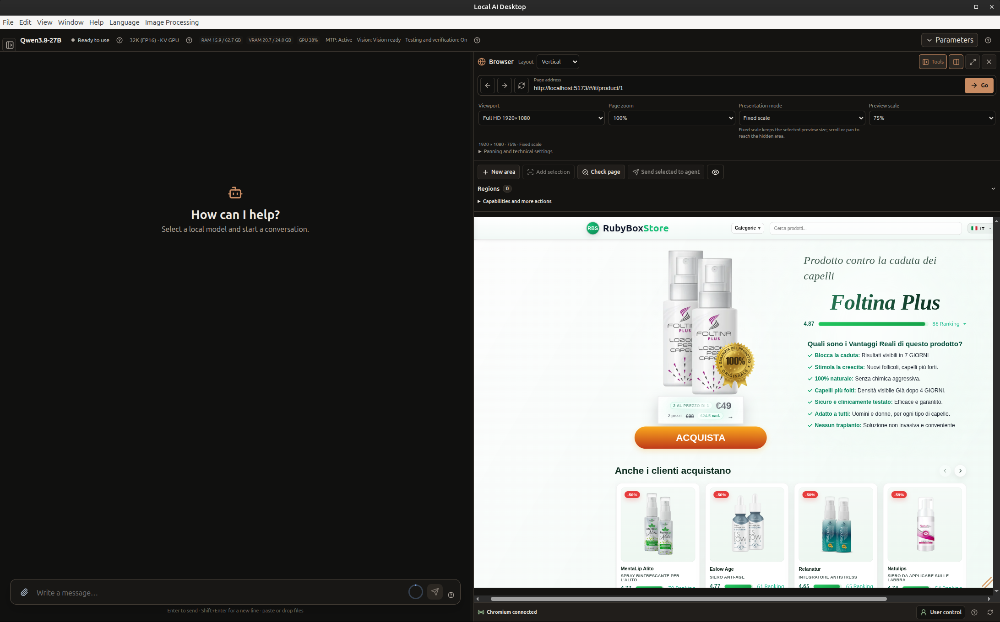
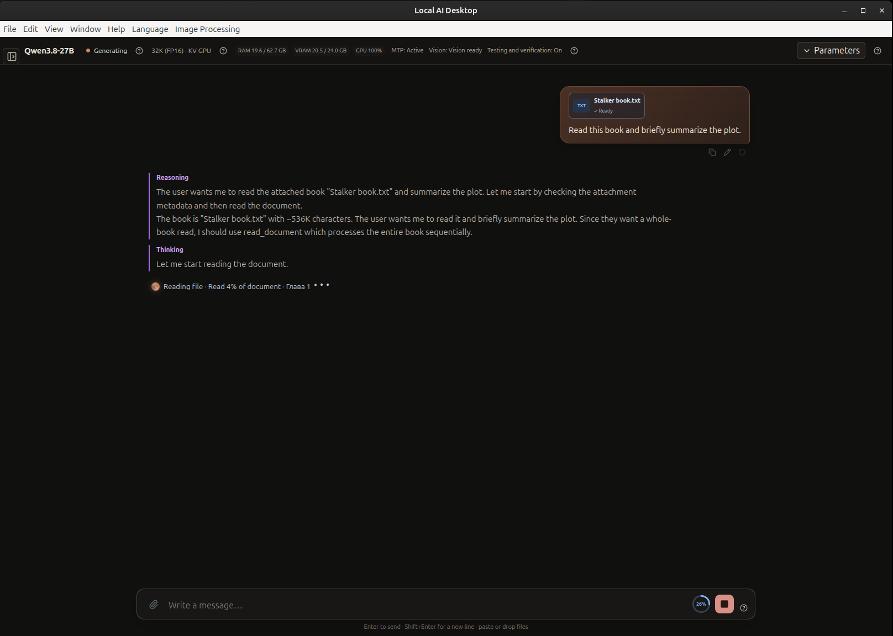

# Возможности

[English](../en/FEATURES.md) · [Русский](FEATURES.md) · [Главная](../../README.ru.md)

Local AI Desktop объединяет чат с локальной моделью и агента для работы над выбранным проектом. Приложение экспериментальное; возможности зависят от модели, файлов, runtime, оборудования и инструкций.

## Чат и ответы

- Запускайте совместимые модели GGUF через основной встроенный runtime `llama.cpp`. Файлы модели выбираются локально, настройки runtime — в приложении.
- Получайте ответы по мере генерации, останавливайте генерацию, редактируйте запрос и запускайте ответ заново. Некоторые настройки рассуждений зависят от модели.
- Прикрепляйте поддерживаемые документы и код. Для изображений нужны модель и projector с поддержкой vision. Приложение локально извлекает текст из поддерживаемых документов, но не выполняет OCR и не рассчитывает формулы таблиц.
- Просматривайте карточки, таблицы, графики, диаграммы и галереи изображений в форматированных ответах. Такое представление не гарантирует достоверность утверждений модели.
- При желании используйте веб-поиск и чтение страниц. Эти инструменты не управляют браузером и не отправляют формы; содержимое сайтов может быть недоверенным.

## Задачи по коду

Выберите проект и попросите Agent изучить файлы, внести изменения и запустить проверки. Агент может составить план, отслеживать результаты и показывать выполненные проверки. Изменения записываются в реальные файлы проекта: проверяйте их и сохраняйте резервные копии.

Задачи сохраняются отдельно от чатов. Можно переключиться на другой чат или задачу, а затем продолжить сохранённую работу. План, прогресс и результаты проверок остаются доступными; продолжение создаёт новую попытку и сохраняет историю предыдущей. Остановка прекращает текущую работу, но не отменяет уже внесённые изменения.

Agent выполняет команды в обязательной изоляции терминала Linux. Некоторые команды и инструменты разработки, которым нужен неподдерживаемый системный доступ, могут быть заблокированы. Доступ файловых инструментов ограничен выбранной областью проекта; изоляция терминала и разрешения файловых инструментов — отдельные меры защиты.

## Разрешения и восстановление

Доступны два режима:

- **Запрашивать подтверждение** — агент просит разрешение на изменения и выполнение команд.
- **Абсолютный автопилот** — обычные действия в пределах текущего проекта и задачи выполняются без повторных запросов.

Оба режима сохраняют одинаковые обязательные ограничения файлового и процессного доступа. Автопилот не расширяет доступ. Некоторые действия остаются заблокированными; разрешения можно отозвать. Подтверждение не отменяет уже выполненную работу.

Если Agent повторяет бесполезные действия, приложение подсказывает ему следующий шаг и может повторить запрос, временно убрав из него повторяющийся фрагмент. Если безопасное восстановление невозможно или ограниченное число попыток не помогло, задача приостанавливается. История остаётся доступной.

Агент сообщает о проверках, которые действительно запускал, например о тестах или сборке. Успешная проверка подтверждает только охваченное ею поведение и файлы, а не полную корректность всех изменений.

## Контекст и память

Выберите точность KV-кэша FP16 или Q8 и размер контекста, который поддерживают модель и runtime. FP16 требует больше памяти; Q8 может сократить её расход с возможной потерей точности. Поиск контекста пробует разные настройки и сохраняет успешно загруженные при текущих условиях варианты. Это практическая подсказка, а не гарантия после изменения модели, оборудования или runtime.

Task Memory сохраняет полезные заметки в рамках одной задачи и не обучает другие задачи. При компактизации контекста часть старой истории беседы может не попасть в запрос модели.

## Экспериментальное размещение и ускорение моделей

В Model Settings доступны размещение GPU-слоёв, динамический MoE-кэш экспертов и GPU KV-cache, если их поддерживают метаданные GGUF и встроенный backend. Стандартный режим MoE не использует динамический кэш; «Автоматический» включается явно и ограничен распознанными моделями/backend; «Ручной» предлагает поддерживаемые бюджеты кэша. Больший кэш может ускорить работу, не повлиять на неё или замедлить. См. [руководство по ускорению и памяти](MODEL_ACCELERATION.md): там приведены измерения Qwen, учёт mmap, ограничения VRAM/RAM и совместимости.

Расширенное размещение читает число блоков и имена тензоров GGUF и позволяет выбирать реальные индексы или диапазоны для GPU. Размещение MoE-экспертов в RAM настраивается отдельно: эксперты могут оставаться в памяти CPU, даже если обычные тензоры того же блока размещены на GPU. Tensor overrides зависят от архитектуры и поддерживаемых backend буферов; номер слоя не означает его специализацию.

## Ответ Agent и потоковая передача

Chat и Agent используют последовательную передачу HTTP/SSE и могут показывать текст по мере поступления событий. Финальный ответ Agent, требующий проверки, может отображаться только после завершения review; посимвольная потоковая передача каждого финального ответа не гарантируется. При транспортной ошибке выполненные действия инструментов сохраняются в истории задачи, автоматического повторного запуска инструментов нет.

## Browser Workspace и Visual Regions

Откройте запущенный локальный веб-проект рядом с Chat или Agent. При необходимости сначала запустите сервер проекта, затем введите его локальный адрес. Можно выбрать мобильный или настольный viewport, изменить масштаб страницы и preview, поменять расположение браузера, свернуть второстепенные панели или развернуть браузер.

Нажмите **New area** и выделите часть страницы; кнопка **Add selection** добавит следующую область. Добавьте выбранные области к запросу Chat или Agent, чтобы объяснить, что нужно изменить или переместить. Приложение может передать сведения об областях, связанные элементы страницы и исходники выбранного проекта. Текстовая модель не видит пиксели браузера напрямую; передача изображений зависит от поддержки Vision моделью и настроек. Исходники сами по себе не подтверждают точное содержимое пикселей. Browser Workspace предназначен прежде всего для локальных preview при разработке, а не для защищённого веб-сёрфинга; ограничения навигации не гарантируют блокировку каждого внешнего сайта.

## Большие текстовые документы

По просьбе прочитать документ целиком Chat может последовательно обрабатывать большое поддерживаемое текстовое вложение. Размер одного вложения — до 25 МБ. Прогресс чтения и подтверждённые заметки сохраняются между сообщениями, прерываниями и compaction. После чтения можно попросить пересказ или задать дополнительные вопросы. Среди поддерживаемых текстовых вложений — `.txt`, `.md`, `.json`, `.csv`, `.log` и текстовые файлы исходников и конфигурации. Другие типы документов используют отдельные способы извлечения; для сканированных PDF нужен OCR, которого в приложении нет. Модель может не вспомнить каждую деталь.

## Границы защиты

Терминал Agent поддерживается на Linux x86_64; основная проверенная среда — Ubuntu 24.04. Для защиты нужны Bubblewrap, Linux namespaces, seccomp и enforcing-профили AppArmor. Если изоляцию запустить нельзя, терминал откажется выполнять команды.

Это не изоляция конфиденциальности: файлы хоста, доступные вашей учётной записи, могут оставаться видимыми; терминал использует общую сеть хоста. Расход ресурсов ограничен не полностью, некоторые инструменты разработки работать не будут. Перед использованием терминала прочитайте [инструкцию по установке](GETTING_STARTED.md). Технические подробности находятся в [справочниках по безопасности и установке](../README.md#advanced-technical-references).

## Пока недоступно

Приложение не включает и не скачивает модели автоматически, не автоматизирует веб-браузер, не выполняет OCR, не предоставляет универсальный откат правок Agent и не координирует несколько агентов. Считайте эти возможности недоступными, пока будущий выпуск явно не заявит обратное.
